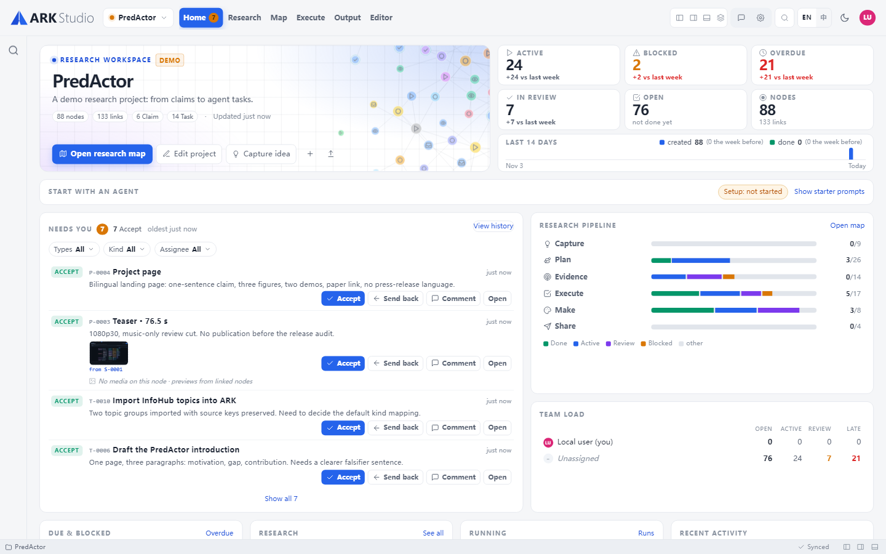
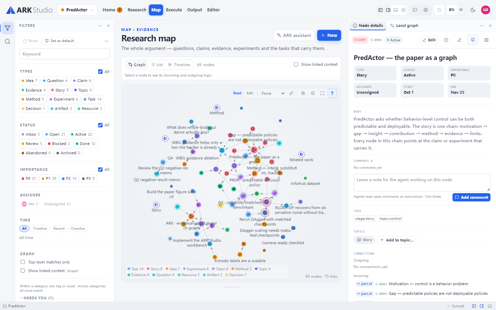
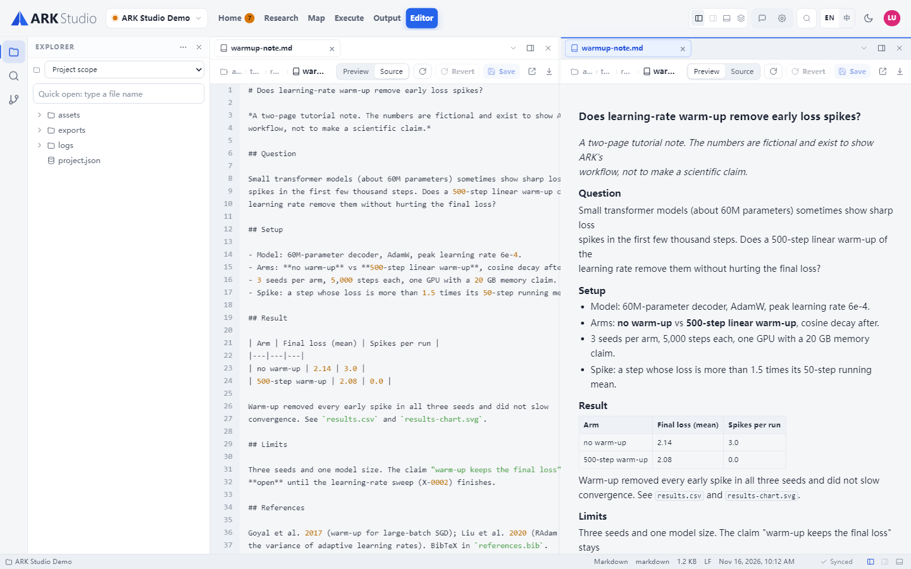

<p align="center">
  <a href="https://github.com/MasterYip/ARK-Studio">
    <picture>
      <source media="(prefers-color-scheme: dark)" srcset="ark_studio/web/brand/ark-lockup-loading-dark.svg">
      <source media="(prefers-color-scheme: light)" srcset="ark_studio/web/brand/ark-lockup-loading.svg">
      
    </picture>
  </a>
</p>

<p align="center">
  <strong>Auto-Research Kit</strong><br>
  A local-first research workspace, from idea to output.
</p>

<p align="center">
  <a href="https://masteryip.github.io/ark-studio-site/"></a>
  <a href="docs/README.md"></a>
  <a href="#getting-started"></a>
  <a href="docs/operations/cross-platform.md#requirements"></a>
  <a href="LICENSE"></a>
</p>

<p align="center">
  <a href="#overview">Overview</a> &middot;
  <a href="#agents-and-integrations">Integrations</a> &middot;
  <a href="docs/guide/mobile.md">Mobile &amp; remote</a> &middot;
  <a href="#development">Contributing</a> &middot;
  <a href="https://github.com/MasterYip/ARK-Studio/issues">Issues</a>
</p>

---

## Getting Started

Give a coding agent with terminal access and access to this repository one of
the prompts below. Replace the placeholders with your server details where
needed. Each prompt asks the agent to complete the setup and verify that it works.

### Run Locally in Your Browser

```text
Install ARK Studio from https://github.com/MasterYip/ARK-Studio on this computer.
Read its README and platform guide, check the requirements, and keep project
data in a persistent folder. Start it on an available loopback port, preferably
8890, verify /api/health, and open it in my default browser. Leave a reusable
launcher and tell me the URL, data location, and how to stop and restart it.
```

### Install the Desktop App

Download ARK Studio for Windows, macOS or Ubuntu from the
[Releases](https://github.com/MasterYip/ARK-Studio/releases) page: the Windows
installer (`…_x64-setup.exe`, or `.msi` / portable `.zip`), the macOS `.dmg`
(Apple silicon or Intel), or the Ubuntu `.deb` / AppImage. No Python is needed.
On first start choose **This computer** to run ARK locally (the app starts its
built-in server, private to you) or **Remote server** to open an ARK server.
Builds are unsigned for now: see [install](docs/guide/install.md) for the
one-time SmartScreen/Gatekeeper step, data locations and uninstalling.

For a headless server, download the single-binary `ark-server` package
(Linux/macOS/Windows archives or a `.deb`); see
[server packages](docs/guide/install.md#server-packages-ark-server).

### Deploy to a Linux Server

```text
Deploy ARK Studio from https://github.com/MasterYip/ARK-Studio to <SSH_HOST>.
Read docs/operations/server-operations.md and the account guide. Use the native server-init
and serve --config commands with persistent data, a dedicated
service account, and a background service that survives reboot. Configure
sign-in and HTTPS at https://<ARK_DOMAIN>, with the ARK backend on loopback
behind the proxy. Keep credentials out of the repository and shell history.
Verify health, sign-in, and streaming, then give me the URL, data and log
locations, and commands to update, back up, restart, and stop the service.
Use standard service supervision; do not create an ad hoc startup script.
```

For private server access without a domain, ask the agent to configure an SSH
tunnel instead. See [remote access](docs/guide/mobile.md#ssh-lan-tunnel-loopback-ark).

### Connect the Desktop App to Your Server

Install the desktop app (above), choose **Remote server**, enter
`https://<ARK_DOMAIN>` and sign in on the server's page. Tick
**Open this choice automatically next time** to go straight there on later
starts. Phones use the responsive web app or the Android app; pair them in
**Settings > Project > Access**.

The core browser app needs no model credentials. Coding-agent providers and
GPU servers are optional integrations configured after setup. For direct
installation commands, continue to [manual setup](#manual-setup).

## Overview

**ARK** stands for **Auto-Research Kit**. It keeps the argument behind a project
alongside the work needed to test it.
A claim can link to supporting literature, an experiment, its execution tasks
and the resulting artifacts. Graphs, outlines, boards and timelines are views
of the same records, so moving between planning and execution preserves context.



## Research From Idea to Output

| Workspace | Purpose |
| --- | --- |
| **Home** | Review project activity, the research pipeline and items that need your decision. |
| **Research** | Develop ideas, structure the story, connect prior work and plan methods and experiments. |
| **Map** | Explore and edit relationships with force, tree, radial and mind layouts, filters and a shared inspector. |
| **Execute** | Track tasks and run agent sessions with conversations, approvals, files, terminals and artifacts. |
| **Output** | Organize research assets, production work and distribution plans. |
| **Editor** | Read and edit project content with links back to the graph. |
| **Assistant** | Ask about project context and act on referenced records through configured model providers. |

Nodes share status, ownership, tags and relationships across these workspaces.
Inline `[[references]]` open the same inspector used by the graph. English and
Chinese interfaces, light and dark themes, and an interactive onboarding tour
are included. On desktop a VS Code style [workbench](docs/guide/workbench.md)
hosts movable views (Search over nodes and files, a local graph, Details,
Explorer, Assistant, Terminal) and saved layout presets.



The shared Markdown renderer supports nested emphasis, tables, embedded HTML
colours, equations and node references. Enable [Git text history](docs/guide/node-history.md)
on selected nodes to compare and restore their titles and bodies through the
Editor, inspector or agent API.



## Manual Setup

### Requirements

- A modern browser.
- The `ark-server` binary from the [Releases](https://github.com/MasterYip/ARK-Studio/releases)
  page, or **Go 1.27 or newer** to build it from a checkout (pure Go, no C
  toolchain).
- Git to clone the repository, use agent worktrees and enable node text history.
- No frontend build step: the web app is plain ES modules. External providers
  have optional dependencies described below.

### Run From Source

The server is `ark-server`, built from `ark_studio/server/` (see the
[development guide](docs/development/development.md)).

```sh
git clone https://github.com/MasterYip/ARK-Studio.git
cd ARK-Studio/ark_studio/server
go generate ./... && go build ./cmd/ark-server   # ark-server.exe on Windows
cd ../..
ark_studio/server/ark-server serve --port 8890
```

Open **<http://127.0.0.1:8890/>**. The server binds to loopback by default.

Select **ARK Studio Demo** to explore a sample research workflow, or create a
project from the project switcher. The onboarding tour introduces the workspaces,
graph editing, filtering and phone access; restart it from
**Settings > Personal > Interactive guide**.

To choose a data directory or skip starter projects:

```sh
ark_studio/server/ark-server serve --root ./my-projects --no-demo --port 8890
```

Run `ark-server --help` and `ark-server serve --help` for the complete CLI
options.

### Desktop and Phone Clients

The [ARK Studio desktop app](docs/guide/desktop.md) (Windows, macOS, Ubuntu)
runs ARK locally with the bundled Go server or opens a remote server in a
borderless native window with a tray menu; see [install](docs/guide/install.md).
On a phone, use the
responsive web app or an Android client. **Settings > Project > Access** exposes available
APK downloads and project-scoped QR pairing. APK availability depends on the
server build. See [mobile access and Android builds](docs/guide/mobile.md).

## Agents and Integrations

ARK works with external tools while keeping project records in its own store:

- **Coding agents:** configurable local CLI providers, including Codex, Claude,
  DSH and OpenCode. Managed sessions expose provider capabilities, permission
  modes, approvals, worktrees and session artifacts. Providers must be installed
  and authenticated separately; support depends on the adapter and CLI version.
- **Project assistant:** a configurable model endpoint with streamed responses,
  reasoning and tool status, and clickable references to project nodes.
- **Agent API and skills:** scoped tokens, structured project context, task
  manifests and reusable skill protocols for research teams.
- **InfoHub:** browse and import source material with provenance and connect it
  to the research graph.
- **GPU execution:** optional SSH-based GPU discovery and a resource-aware queue,
  including task colocation when the configured limits allow it.

Start with [provider configuration](docs/agents/providers.md),
[DSH setup](docs/agents/dsh.md), [external-agent access](docs/agents/external-agent.md),
[the agent contract](docs/agents/agent-interface.md) and [GPU setup](docs/operations/gpu.md).
The core workbench runs without a model account or GPU server.

## Data and Deployment

The server is the Go `ark-server` (one binary, pure Go SQLite).
It stores data in SQLite; the browser UI uses
native ES modules and Canvas. Project content is stored in portable project
folders, while organization accounts and agent-session logs live separately.
Default locations are relative to the directory where the server starts:

```text
runtime/
  projects/          Project folders, manifests, SQLite data and project assets
  org.sqlite3        Accounts, teams, project grants and personal settings
  agent-sessions/    Agent conversation logs and session workspaces
```

Back up the complete project folders. For a server backup, include the
organization database, its credential-sealing key and any session files you need.
Do not commit runtime databases, tokens, provider credentials or private keys.

For shared or remote use, ARK supports accounts, organization roles and project
grants. Public mode requires authentication. Use HTTPS or an SSH tunnel for
remote connections; see [accounts and access](docs/operations/accounts-and-access.md),
[cross-platform operation](docs/operations/cross-platform.md) and
[mobile and remote setup](docs/guide/mobile.md). The browser cache stores the app shell,
not API responses. An available shell does not replace a running server.

## Development

Work directly from a checkout. The backend gate builds `ark-server` and runs
gofmt, `go vet`, `go test`, the contract suite against the fresh binary and the
JavaScript tests (Node 18 or newer; Python 3.10+ runs the contract suite).
Node is needed for development checks, not for running the app.

```sh
scripts/dev/check-backend.sh            # Linux, macOS, Git Bash
scripts/dev/check-backend.ps1           # Windows PowerShell
```

Run a separate instance with temporary project and session roots when testing
changes. See [the development guide](docs/development/development.md) for
focused checks, screenshots and contribution guidance.

Issues and pull requests are welcome. Include reproduction steps, the platform
and relevant logs with credentials removed. For behavior changes, describe the
expected result and include checks that cover it; for UI changes, include a
screenshot at an appropriate desktop or mobile size.

## Author

Created and maintained by **[Raymon Yip (MasterYip)](https://github.com/MasterYip)**.

[Source repository](https://github.com/MasterYip/ARK-Studio) |
[Issues](https://github.com/MasterYip/ARK-Studio/issues)

## License

ARK Studio is released under the **[GNU Affero General Public License v3.0](LICENSE)**
(AGPL-3.0). Copyright (c) 2026 Raymon Yip.

You may use, modify and redistribute ARK Studio, including commercially, as long
as you publish the complete source of your version under the same licence. This
also applies when you only run a modified version as a network service.

Commercial licences for closed-source use or embedding are available. Contact
Raymon Yip at raymon-yip@qq.com ([GitHub](https://github.com/MasterYip),
[homepage](https://masteryip.github.io)).

Releases up to v2.0.0 were published under the MIT License; those copies remain
under it.

Third-party components retain their respective licenses, including notices under
`ark_studio/web/vendor/` and `ark_studio/server/internal/skillkit/LICENSES/`. See
[skill attribution](docs/agents/skills-attribution.md) for bundled skill provenance.
