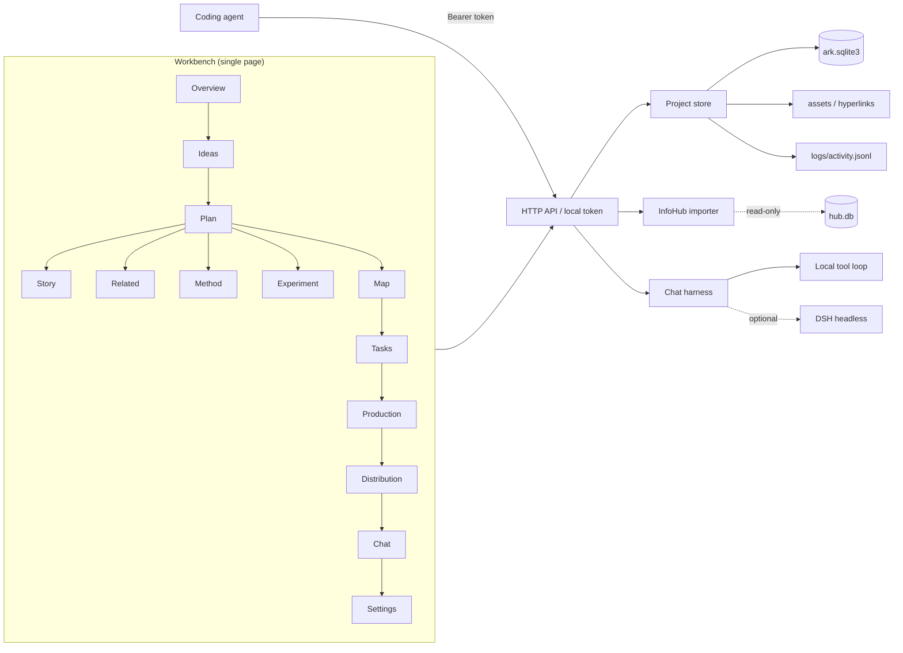

# ARK Studio — design note

## 1. One project, one graph, one database



A tab is a **preset filter/view over the same units**, not a separate database.
The six stages of the demo (capture, plan, evidence, execute, make, share) are
also projections over type counts.

## 2. Unit and tag contract

```text
unit(id, uid, type, title, body, status, importance,
     start_at, end_at, created_at, updated_at,
     origin, source_ref, source_title, meta_json, archived)
unit_tags(unit_id, tag)
unit_links(id, source_id, target_id, relation, note, created_at, created_by)
unit_media(id, unit_id, url, kind, caption, created_at)
activity(id, at, actor, action, unit_id, detail_json)
chat_messages(id, at, role, content, tools_json, meta_json)
```

- Exactly one `type:` tag; `status:` and `importance:` are defaulted.
- Reserved values are validated by `arkstudio/tags.py`. Everything else is free.
- Namespaces may be non-ASCII (`大话题:`), and values may contain `:`
  (`source:lark:org2`); the first colon separates the namespace.
- Links are directed; the UI always adds reverse navigation.
- `part_of` is stored as `child → parent`. The importer reverses InfoHub's
  `parent_id → child_id` rows to preserve that invariant.
- Media is a URL/path, never a BLOB. `file://`/relative files are served only
  under the project or an explicit `--media-root`.

## 3. Tabs and default views

| Tab | Types | Default | Other views |
|---|---|---|---|
| Overview | all | dashboard | — |
| Ideas | idea, source, question | graph (+ linked context) | list |
| Plan / Story | story | outline | split, graph |
| Plan / Related | related_work | list | graph |
| Plan / Method | method | list | graph |
| Plan / Experiment | experiment | list | timeline, graph |
| Map | question, claim, evidence, experiment, task, idea, story, method, decision | graph | list, timeline |
| Tasks | task, milestone, agent, host, artifact, resource | sessions | board, timeline, agents, library |
| Production | production, artifact, resource | boards | — |
| Distribution | outreach, milestone, production | channels + calendar | — |
| Chat | all (read/write tools) | conversation | — |
| Settings | project | graph physics | — |
| Editor | project files + node attachments | open-file tabs (empty state: recent files) | per file: preview/source, pretty, table |

The top bar groups the views into six main workspace tabs (Home, Research,
Map, Execute, Output, Editor); Assistant and Settings are icons on the right.
The main tabs are **fixed**: they never shrink or scroll at any desktop or
tablet width. The active workspace's sub-tabs (Plan stages, Execute views,
Output views, or the Editor's open files) follow on the same row in
`.top-subnav-scroll`, the only part that scrolls sideways when space runs out
(mouse wheel, trackpad, touch), with fade edges on the side that has more
content and the active sub-tab kept in view. At 1024–1320 px the brand word,
search label, language toggle and button labels collapse so the right-hand
actions still fit. On phones (≤760 px) the bottom bar stays fixed and the
sub-tabs replace the page title as a scrollable chip row.

### Editor workspace

`#/editor` (and `#/editor/<encoded key>`) is a VS Code style viewer/editor for
project files and node attachments (`web/js/views/editor.js`; the pure tab
model, persistence and type mapping live in `web/js/editor-model.js` with
`tests/js/editor_model.test.mjs`).

- **Tabs** are the workspace sub-tabs in the top bar (phone: the title row).
  Keys are `ws:<path>`, `media:<id>` or `url:<href>`; reopening a source focuses
  its tab. A single click in the explorer opens an italic *preview* tab that
  the next single click replaces; double-click or editing pins it. Each tab
  has a close × (middle-click also closes), a ● dirty marker, and a context
  menu with Close, Close Others, Close to the Right, Close Saved and Close All;
  a "Close all" control sits at the end of the strip. Tabs can be dragged to
  reorder. Closing a dirty tab asks first; leaving the page with unsaved edits
  triggers the browser's unload prompt. Order, active tab, preview flag and
  recent files persist per project in `localStorage` (`ark.editor.v1.<id>`);
  unsaved text is never persisted.
- **Shortcuts**: Ctrl+S saves and Ctrl+W closes the active tab (configurable in
  Settings → Shortcuts; these two actions may claim the otherwise reserved
  browser keys). A normal browser tab keeps Ctrl+W for itself; the installed
  app window delivers it.
- **Opening**: the Editor's explorer and quick open (workspace tree/search
  API); "Open in Editor" on each attachment in the attributes panel (clicking
  a previewable attachment opens it as a preview tab); "Open in Editor" in
  the Changes view (git diffs open as Editor tabs); the command palette.
- **Former Execute → Files** lives in the Editor: the explorer (with a
  per-task-session tab set), the Changes view (git changes against a base
  ref; diffs open as read-only `diff:` tabs) and the Terminal view (bottom
  panel; a drawer under the viewer in the classic layout and on phones).
  Old `#/execute/files` links open the Editor.
- **Viewers** by type: images (png/jpg/gif/webp/svg/bmp/ico/avif, SVG through
  ``), video (mp4/webm/mov/m4v/ogv, `<video controls>`), audio, PDF (the
  browser's viewer in an `<iframe>`), Markdown (rendered with `richText`, with a
  source toggle), JSON (pretty-printed or source), CSV/TSV (table, first 2000
  rows, or source), text/code (line numbers + `highlightCode`), and an info
  card with "Open with system app" (`/api/open`) and Download for external
  links, binary/unknown formats and files over the 1 MiB text limit.
- **Editing** is limited to project text files through `/api/workspace/file`
  (1 MiB limit, `base_hash` conflict check, reload banner on 409).
  Attachments served by `/api/media/{id}/raw` are always read-only and say so.
- **Server**: `/api/media/{id}/raw` and the new `/api/workspace/raw` stream
  files with single-range HTTP `Range` support (206/416), so video can seek.
  Only image/video/audio/PDF/plain-text types render inline; anything else is
  sent as an attachment (`application/octet-stream`). Previews carry
  `Content-Security-Policy: sandbox; default-src 'none' …`. PDFs are the one
  exception: Chromium will not run its PDF viewer in a sandboxed document,
  under `object-src 'none'` or when framing is denied, so PDF responses get
  `default-src 'none'; object-src 'self'; frame-ancestors 'self'` and
  `X-Frame-Options: SAMEORIGIN` (framing by ARK itself only; still no scripts,
  forms or connections). Every other response keeps `frame-ancestors 'none'`.
- **Phones**: Editor has no bottom-bar slot (six destinations already fill a
  360 px bar). It is the first entry of the "More" sheet and the last chip of
  Execute's sub-tab row, and the Execute slot stays highlighted while the
  Editor is open. The explorer overlays the viewer and starts closed.

#### Node tabs (`unit:<uid>`)

Node titles and Markdown bodies can optionally use [Git text history](../guide/node-history.md).
The node context menu, inspector clock and Editor clock open the same GUI:
enable recording per node, choose revisions, compare side by side (unified on
narrow windows), preview rendered text or restore as a new revision. The bare
repository lives inside `<project>.ark/history.git/`; SQLite stores each node's
tracking switch and head. Media bytes and other node fields are not versioned.

Any ARK node can be opened as an Editor tab (`web/js/views/node-editor.js`):
a wide, document-like editor with the same data and rules as the attributes
panel. Pure pieces live in `web/js/node-model.js` (draft, validation, PATCH
body, link rows; `tests/js/node_model.test.mjs`); `web/js/unit-edit.js` holds
the save/upload/open helpers the inspector now shares.

- **Opening**: "Open in Editor" (Alt+Enter) in every node context menu: the
  canvas graph (map, mind map, research map, dashboard graph) and, through
  one delegated listener in `web/js/unit-menu.js`, every DOM row/card tagged
  `data-unit-ref` (cards, task board, outlines, Gantt rows, asset grid,
  outreach and dashboard lists; double-click opens too). Also the inspector
  header button, the production report dialog and links inside a node tab
  (click = preview tab, Ctrl/middle-click = pinned tab). Reopening focuses
  the existing tab. Tabs behave exactly like file tabs (preview/pinned, ●,
  confirm on close, persistence, Close All).
- **Layout**: header (title, type, status, importance, start/end, tags,
  assignees, provenance), body as **Source / Split / Preview** with a
  debounced (220 ms) live preview, a media gallery (inline seekable
  video/audio, images with a lightbox, PDF/HTML/file cards; caption edit,
  insert-into-body, open in Editor/system, remove, add URL, upload, drag-drop,
  paste image), incoming/outgoing links, and an activity strip. Phones stack
  everything and start in Preview.
- **Saving**: Ctrl+S → `PATCH /api/units/{id}` with the inspector's body
  shape and validation (title required, ≤ 240 chars, end ≥ start). Before
  writing, the tab re-reads the unit; if `updated_at` moved and the fields
  differ from what it loaded, a banner offers Reload or Overwrite (the API
  itself is last-write-wins). Captions use the new `PATCH /api/media/{id}`.
- **Consistency**: every save dispatches `ark:unit-saved`. An open inspector
  without pending edits re-renders; clean node tabs adopt the new values and
  dirty ones show the conflict banner.

#### Rich rendering (`richText`, all views)

- **Mermaid** ```` ```mermaid ```` blocks render with the vendored
  `web/vendor/mermaid` (lazy-loaded, runtime-cached by the service worker, not
  precached: 2.7 MB) using `securityLevel: "strict"` and ARK's light/dark
  theme (diagrams re-render when the theme flips). SVGs are cached by
  theme + source, renders are serialised, and the node preview patches only
  changed blocks, so typing does not flicker; a stale diagram stays visible
  until its replacement is ready. Parse errors show an error card with the
  source.
- **LaTeX**: `$…$` and `$$…$$` through the existing lazy KaTeX path.
- **Media**: `` → ``, `` / `[label](x.mp4)` / bare
  video URLs → `<video controls>` (audio likewise). URLs resolve through
  `rich-model.js resolveRichUrl`: `media:12` and `/api/media/12/raw` are
  attachments (kind from the unit's media list), relative paths are project
  files via `/api/workspace/raw` (relative to the Markdown file's folder in
  file previews), ARK API URLs get the mobile token; `javascript:`, `data:`,
  protocol-relative and other schemes are dropped.
- **File previews** use the same renderer: Markdown, `.mmd`/`.mermaid`
  (diagram, with a source toggle) and `.html` (sandboxed frame below, with a
  source toggle).
- **Raw HTML in Markdown**: node bodies, editor previews and other rich-text
  surfaces share support for inline markup, tables, details/summary, images,
  video and audio. The vendored Marked parser handles all block and inline
  Markdown, including combined/nested bold and italic, reference links, nested
  lists and GFM tables/tasks. ARK adds node references, citations and math as
  lexer extensions; it does not parse emphasis with regular expressions.
  DOMPurify sanitises
  fragments before they enter the document. Relative media and links use the
  same workspace resolution and phone authentication as Markdown media.
  Inline text, background, border, outline and decoration colours are preserved,
  including standard CSS colour formats and legacy HTML colour attributes.
  CSS declarations are parsed with the browser and restricted to colour
  properties. Scripts, event handlers, forms, frames, custom classes/IDs and
  non-colour styles are removed. Interactive HTML/CSS/JavaScript belongs in the sandboxed HTML
  code blocks described below. Inline code and non-HTML code fences remain text.
  References in visible HTML text use the same capsules as Markdown references;
  code and escaped references remain literal. History previews share this renderer.

#### Embedded HTML visualisations — security model

```` ```html ```` blocks and `.html` attachments never touch ARK's DOM.

1. ARK creates `<iframe sandbox="allow-scripts" src="viz-frame.html">`,
   **without `allow-same-origin`**, so the content runs in an **opaque
   origin**: `parent.document`, cookies, `localStorage`, the mobile token and
   same-origin API calls are all unreachable (the browser smoke asserts each
   one throws). No popups, forms or top navigation either.
2. `web/viz-frame.html` is served with its own CSP: `sandbox allow-scripts;
   default-src 'none'; script-src 'unsafe-inline' 'unsafe-eval';
   connect-src 'none'; img-src/media-src data: blob:; frame-ancestors 'self'`
   (+ `X-Frame-Options: SAMEORIGIN`). So even opened top-level it is
   sandboxed, and a visualisation cannot fetch/XHR/WebSocket anything; it must
   be self-contained. ARK's own `script-src 'self'` is unchanged.
   *Why not `srcdoc`*: a srcdoc document inherits the parent's CSP, so ARK's
   `script-src 'self'` would block every inline script, and relaxing ARK's CSP
   is not acceptable. The bootstrap page receives the HTML by `postMessage`
   (accepted only from `window.parent`) and `document.write`s it.
3. The only message ARK accepts back is `{type:"ark-viz-size", id, height}`,
   validated by `acceptVizMessage` (`rich-model.js`): the source must be the
   exact `contentWindow` ARK registered for that id, height must be a finite
   number, clamped to 60–4000 px. Anything else is ignored.
4. **Opt-in per block**: a visualisation runs only after "Run visualisation";
   the block shows a "Sandboxed" badge and a source toggle. Node bodies are
   often written by agents or imports, so viewing a node must not execute
   code, and an endless loop in a same-process frame could freeze the tab.
   Once run, the approval is remembered for that block (tab + block index) for
   the browser session, so the live preview keeps it running while you type.
5. Residual risk: a script can still navigate its own frame to an external
   URL (CSP cannot forbid self-navigation), which could leak the block's own
   source — the only data it was given.

## 4. Write path

All writes go through `Store`:

- UI → `POST/PATCH/DELETE /api/...` with same-origin enforcement.
- Coding agent → `/api/agent/v1/...` with `Authorization: Bearer <token>`.
- Chat → `POST /api/chat`; the local harness calls `Store`, the optional DSH
  process gets the same API token and can call `/api/agent/v1/...`.
- CLI/seed/tests → the same `Store` methods.

Every mutation appends an `activity` row (and mirrors it to
`logs/activity.jsonl`). The manifest's `updated` timestamp is touched. There is
no second writable projection.

## 5. Filter semantics

- `q` — substring on title/body/uid.
- `types`, `statuses`, `importance` — set membership.
- `tags` — **all** selected tags must be present (AND). Type and status are
  separate selectors and are not duplicated in the tag list.
- `from`/`to` — overlap with a unit's dated window.
- Facets are computed with the tag filter removed so a user can still see
  alternatives in the same namespace.
- Graph and Gantt receive the same parameters. Graph "context" adds one-hop
  neighbours, explicitly marked `context: true` and drawn faded.

## 6. Research map and narrative graph

The demo story hierarchy is represented by one graph:

- Story root + seven sections (`part_of`, `seq:` tags for order).
- Each section points at questions, claims, experiments, methods, or evidence.
- Claims are supported by evidence and validated by experiments.
- Tasks are `part_of` experiments and `assigned_to` agents; agents and tasks
  `runs_on` hosts.
- Production and outreach sit downstream of claims/evidence and milestones.

Ownership is a separate field. `units.assignee` (schema v3) names the ARK
account that owns or maintains a node, and whose agents work on it, or is
`null`. Reads also return `assignee_effective`: the node's own value, else the
nearest `part_of` ancestor's, so assigning a branch root assigns the branch.
`assigned_to` links are unchanged: they attach the **agent** units that do the work (in practice always `agent` nodes, shown as "Assigned agents" / 指派的智能体), while `assignee` names the human account that owns the node. Filters take `assignee=<user>|none|me` and match the effective value.
Only accounts that have joined the project (a user or team grant; in local
mode just the local user) can be assignees: the server refuses anyone else
with a 400, and the inspector picker and the **Assign to** submenu of every
node right-click menu (Map graph, mind map, cards and lists) offer project
members only, with "Me" only when the current user is one. In the graph the
submenu applies to the whole selection; read-only members and read-only phone
sessions get it disabled. Nodes may keep an assignee who later left; the
filter rail still offers that name, marked "no longer a project member".
A create without an `assignee` key is assigned to the creating account (the
signed-in user, the account behind an agent-API call's session, or the local
user without accounts); an explicit `null` leaves it unassigned and
inheriting. System writes (seed, demo, migrations) are never assigned.

Default dates (schema v5). A create without `start_at` gets the creation date;
a unit that becomes `done` with no `end_at` gets that date. Explicit dates win,
a planned `end_at` (deadline) is kept on completion, and a default that would
contradict an explicit date (start after the given end) is skipped. Reopening
keeps `end_at` as the last completion until the caller clears or changes it;
the next completion fills it only if it is empty. The v5 migration fills the
same defaults on existing units once (`start_at` from `created_at`; `end_at`
of done units from the last status-change activity entry, else `updated_at`),
and assigns unassigned units to the account in their `unit.create` entry when
that is a real account. Each fill is a `unit.backfill` activity row by
`system:migration`; `updated_at` is unchanged. The Gantt draws an open unit
with a start and no end as an ongoing bar up to today.

The `needs:` tag records that a node waited on the user and how it ended.
The store sets it on every create/update/archive (clients cannot set or remove
it): `needs:review` / `needs:decision` while pending, then `needs:accepted`,
`needs:sent-back`, `needs:decided` or `needs:dismissed`; a node back in
`review` returns to `needs:review`. One per node, never removed. Older
projects are backfilled once on open (current review / open decision nodes
only). The filter rail shows it as the "Needs you" group, and Home's "View
history" opens the Map filtered to all of it.

The Story tab defaults to the readable outline. Its **Split** view puts the
outline beside a focused graph (story + claims + experiments); **Graph** drops
the outline. The Map tab shows the broader argument.

## 7. Graph physics and project settings

The canvas uses Info Hub's `graphPhysicsStep` rather than a generic d3-like
simulation:

```text
repulsion  f = repulsion / max(64, d²)       (inverse-square, softened start)
spring     f = (d - distance) * 0.02          (linear, on every edge)
gravity    v += (center - p) * gravity        (linear, screen-centre point)
damping    v = clamp(v * (1 - damping), ±30)  (then p += v)
alpha      alpha *= 0.985, stop below 0.02; alpha is NOT a force multiplier
```

The UI's 0–100 sliders use the same non-linear curves as Info Hub (cube root
for repulsion, reciprocal cube root for gravity). Defaults are controls
`59 / 0 / 95 / 30` = raw `3286.064 / 0 / 0.0115061 / 0.30`.

Settings are **project-scoped** and stored in `project.json`:

```json
{"settings": {"graph": {"repulsion": 3286.0639999999985, "distance": 0,
  "gravity": 0.011506123058542407, "damping": 0.3}}}
```

`PATCH /api/project/settings` validates every key/range, writes the manifest, and
logs `project.settings`. The frontend's `physics.js` owns the control curve and
`graph.js` registers every live GraphView so a saved value reheats all open
graphs. The Settings tab has a live preview that re-settles on every slider
change.

## 8. Mind graph editing

The **Mind** layout is a left-to-right logic tree. Hierarchy is drawn only from
`part_of` / `derived_from`; a node without such a parent is an explicit orphan
root. ARK never guesses a level. Sibling groups under one parent share an
alignment edge, while separate parents may begin at different x positions.

- `Space` / double-click: inline title; `Tab`: child; `Enter`: sibling below;
  `Shift+Enter`: sibling above. Sibling creation with no parent creates an
  orphan (with a notice), matching the "level unclear" rule.
- Hovering a link highlights it and shows its relation. `Alt` + drag from source
  to target writes a directional link with the placeholder relation `unset`;
  clicking a link opens the relation picker. This avoids a modal on every drag
  while keeping the relation editable. Connect is applied locally so it never
  switches the graph layout.
- `Delete`/`Backspace` confirms, archives, and removes the selected node(s).
- Edit operations re-run layout without changing zoom/pan; a per-view camera is
  also restored after a route refresh (relation/import changes). Panel/canvas
  resizes never recenter the camera; dragging a node while zoomed preserves the
  exact zoom/pan. A dragged force node rejoins the simulation on release;
  labels are skipped off-screen and clipped at the frame
  edge rather than being pulled back inside.
- `Ctrl` + click toggles multi-select; a plain click elsewhere clears it.
  Right-click opens bulk tag/status/importance editing.
- Single-clicking a node opens the inspector as a fixed right-side column with
  no backdrop/dimming; the graph remains interactive. Its pin button keeps the
  panel open across operations; unpinned panels close on the next outside click.
- Hover labels deliberately have no background and no bold; they are black text
  with a contrast halo.
- Settings → Mind graph stores left-edge vs centered alignment and auto-layout
  in browser-local preferences. Auto-layout off permits free node dragging and
  suppresses re-flow after edits.
- New nodes are inserted optimistically into the canvas and then written through
  the ordinary API; the route refresh is not required to see the edit.
- Shortcuts are browser-local (`localStorage`), editable in Settings. The
  project-scoped physics remains in `project.json`.

## 9. Chat and harness

The Chat tab and **Alt+J** expose a project agent. Messages persist in
`chat_messages`; tool results are shown as cards and every write is normal
activity.

- **Local ARK harness (default)**: a deterministic command/tool loop for create,
  link, update, search, dispatch, and project summary. No model/key.
- **Optional DSH**: `ARK_DSH_COMMAND` is a headless DSH process with the `.ark`
  folder as cwd and the ARK API base/token in the prompt. DSH can edit files and
  call the API; if it fails, the local harness handles the turn. The adapter is
  a process boundary, not a vendored submodule (see `docs/agents/dsh.md`).

## 10. Task sessions and agent harness

Tasks has two related halves. **Dispatch** remains a handoff: a task is a
`type:task` unit with links to the claim it targets, the experiment it belongs
to, an agent and a host. The modal emits a Markdown contract with UID, window,
claim, experiment, agent, host, gates, stop conditions, and report requirements;
copying it is the handoff, and "Move to active" changes status.

**Sessions** is the executing path, owned by the server:

```text
Browser (Tasks → Sessions workspace)
   │ POST /api/agent-sessions
   ▼
SessionManager ── Popen(argv, cwd=workspace, env=scrubbed) ── reader threads
   │  meta.json, stdout.jsonl, stderr.jsonl                  │
   │  read-only token, ark-context.json                      ▼
   └──── GET logs / transcript / media / artifacts ◄──── agent process
```

- **Workspace.** Tasks → Sessions is a three-pane workspace. The left rail
  filters/groups sessions and subagents; the center renders the normalized
  conversation with tool cards and a composer; the right rail tabs through
  Overview, Subagents, Media, Docs and Artifacts. Session selection is local
  state, not a route change, so switching never reloads the page.
- **Lifecycle.** Start validates a configured preset, a workspace-relative cwd,
  a task reference and an optional initial prompt. It creates
  `runtime/agent-sessions/<id>/{meta.json,stdout.jsonl,stderr.jsonl,workspace/}`,
  generates the read-only context and contract, then `Popen`s the command with a
  Windows new process group (or POSIX session). Starting never blocks HTTP.
- **Streaming.** Two daemon reader threads append JSONL entries and update
  last-activity/counters under a per-session lock. The UI polls `offset`-based
  chunks every 1.6 s; there is no SSE/websocket dependency. The UI says
  "agent running/idle/completed" and never fakes token-level streaming.
- **Transcript normalization.** `arkstudio/session_transcript.py` maps complete
  stdout/stderr lines to user/assistant messages, tool calls and results,
  permission requests/resolutions, errors, reasoning and notices. It understands
  the `[[ark-event]] {json}` adapter protocol, generic/Claude Code
  `permission_request`/`control_request` JSONL and common Codex /
  OpenAI-compatible shapes; unknown output is preserved as Markdown. Tool calls
  are paired with results by id, unpaired results remain visible and approval
  cards are overlaid with the decision state stored in `meta.json`.
- **Permission modes and approvals.** The backend owns five validated modes:
  `read_only`, `plan`, `ask`, `accept_edits` and `full_access`. Presets declare
  `permission_modes` and `supports_approval`; approval modes are stripped from a
  preset that cannot keep stdin open, so the UI shows the limitation instead of a
  fake prompt. Each turn records its mode in `permission_history`. In `ask` and
  `accept_edits` the adapter emits a `permission_request` line and ARK answers on
  stdin with `permission_response` (`allow`/`deny`, scope `once`/`always`/`auto`);
  Claude `control_request` frames get `control_response`. Mode policy auto-denies
  in read-only/plan, auto-allows file edits in accept-edits, honours user
  "always allow" rules, and expires pending requests when the process ends. Only
  full access receives ARK's write token—ARK cannot intercept an adapter's own
  filesystem calls, so approval modes stay token-free and the contract says so.
- **Queued turns and side chats.** The steer queue is visible in the composer;
  still-queued entries can be edited, reordered and removed, while delivered input
  is read-only. `POST .../fork` starts a real linked child session
  (`parent_id`, `relation:side_chat`, `side_chat_of`, `forked_from`) whose first
  prompt includes a bounded snapshot of the parent conversation. It has its own
  workspace, so parent files are never silently shared.
- **Media index.** `GET /api/agent-sessions/{id}/media` walks the workspace
  (bounded depth/count, symlinks and hidden files skipped) and classifies image,
  video, audio, document and other files. It lists metadata only; bytes still
  flow through the scoped artifact endpoints.
- **Status.** `running` while alive; `idle` after 90 s without output; `stopping`
  while a kill worker runs; `stopped` on exit 0 or user stop; `errored` on a
  non-zero exit/spawn failure. A server restart marks detached sessions stopped.
- **Follow-up.** Interactive presets write input to the process stdin. One-shot
  print/exec presets advertise `followup: false`, and the UI disables the
  composer instead of silently dropping input.
- **Stop.** The API returns immediately after flipping the state; a daemon
  worker runs `taskkill /PID <pid> /T /F` on Windows (or a POSIX process-group
  signal, escalating to SIGKILL), then the monitor thread settles the status.
  Archive/delete are only allowed once stopped, so a live process cannot keep
  writing into a moved/deleted workspace.
- **Read-only project access.** The child environment is a copy of the host
  environment minus `ARK_AGENT_TOKEN`, any `ARK_*` name containing
  TOKEN/SECRET/PASSWORD/CREDENTIAL, and any value equal to the server write
  token. It receives `ARK_PROJECT_PATH`, `ARK_TASK_CONTEXT`,
  `ARK_READ_TOKEN` and `ARK_TASK_API_BASE`. The read token is distinct from the
  write token and authenticates only the GET-only
  `/api/task-agent/v1/{context,project,units,links,snapshot,session}` namespace.
  All POST/PATCH/DELETE under that prefix return 403. The write token is rejected
  by the read API; the read token is rejected by `/api/agent/v1/...`.
- **Artifacts.** `GET /api/agent-sessions/{id}/artifacts[/read|/download]` is
  rooted at the session workspace. Paths are workspace-relative, normalized with
  `Path.resolve()`, and rejected if absolute, containing `..`, outside the root,
  or a symlink. Text previews cap at 256 KB and downloads at 8 MB. The inner
  assistant reads the same endpoint, so task outputs are visible without granting
  agents project write access.
- **Boundary honesty.** The project path is passed for reading and the contract
  is explicit, but a same-user subprocess is not OS-sandboxed. The enforced
  guarantee is at ARK's API/tool layer; stronger isolation (ACL copy-on-write
  view/container) is future work and is documented in the README.

Presets are operator config, not bundled agents: `dsh`, `claude`, `codex`,
`shell`, a built-in `echo` demo, and an optional `custom` command from
`ARK_TASK_CUSTOM_COMMAND`. Availability is probed on `PATH` and unavailable
presets are disabled in the launcher.

Cross-device state is still modeled, not executed: `type:host` units carry
`os:`, `gpu:`, `device:`, `status:` tags; agents carry `host:`, `model:`,
`role:`; tasks link `runs_on`/`assigned_to`. A future supervisor can consume
this without changing the data model.

## 11. InfoHub integration

InfoHub remains the intake membrane. The importer opens `hub.db` with
`mode=ro`, maps kinds, preserves `source_ref`, tags and parent links, and is
idempotent. The real local database currently yields 932 units / 341 topics;
importing topics into a blank project is a ~3.7 s operation with 341 units and
220 links in this environment.

Pasted outlines are handled by a deterministic parser (`/api/assistant/extract`):
a bullet or paragraph becomes one idea with `origin:assistant`, an optional
`derived_from` source link, and `topic:intake`. This is explicitly not a model
call; it is the low-friction bridge from a brainstorm to nodes.

## 12. InfoHub split explorer

Ideas has an **Import InfoHub** toggle. Off, only the full-width ARK graph is
shown. On, two independent GraphView canvases split the content width:
**InfoHub** (left, read-only) and **ARK** (right, editable). The filter rail has
two tabs: **InfoHub** drives the left source graph through
`GET /api/infohub/graph` using the Explorer contract (keyword, multi-kind,
tags (grouped by namespace), status, a slider + decimal-days activity window,
scope, order, roots, one-hop context, "only linked nodes"); all filtered nodes
are returned up to 1000, with only linked off by default. **ARK** keeps the
normal project filters for the right graph. Node
colour follows InfoHub's `KIND_COLOR` palette, radius follows total message
count, and `for_me` gets the amber ring. Dragging a node out of the left canvas
and dropping it on the right calls `POST /api/infohub/import` for that key only;
the returned unit is inserted at the release point without refetching or
re-laying out the ARK graph. Dropping on a node also adds a `derived_from`
link. No list-to-graph shortcut and no bulk copy are involved.

## 13. Security and retention

- Loopback by default; foreign Host rejected.
- Cross-origin writes rejected; agent writes require a token.
- Task-session read tokens are distinct from the write token, only unlock GET
  routes under `/api/task-agent/v1/`, and are listed only on the session detail
  endpoint. The child environment never receives the write token.
- Session artifacts are confined to `runtime/agent-sessions/<id>/workspace`;
  absolute paths, `..`, escaping symlinks and symlinked files are refused.
- CSP restricts scripts to self; no inline scripts.
- `runtime/projects/` and `runtime/agent-sessions/` are git-ignored; the project
  itself is portable.
- Export produces identity-bearing JSON/Markdown/CSV/SVG.

## 14. Dockable layout and session bar

Three topbar toggles control filters, attributes and the bottom assistant
session dock. The attributes drawer has a docked mode (reserves `--inspector-w`,
no shadow, no entry animation; clicking a new unit re-renders in place) and a
floating mode (anchored near the click, 70% of the docked width, shadowed,
closes on outside click). The
pin button switches modes. Rail and inspector widths, floating inspector
width/height, and session height are drag-resizable and stored in browser
preferences. The assistant session dock is
docked at the bottom of the middle content zone (between rail and inspector),
with no shadow; it shrinks the content rather than floating over it.

InfoHub filter edits update only the left graph through
`ctx.updateInfoHubGraph`; they do not recreate the route or rail, so the filter
scroll position and graph camera survive. All tag facets are returned and rendered namespace-by-namespace in the filter
rail’s own vertical scroller; there is no nested Tags scrollbar and no
horizontal scrollbar. The activity-window
slider max is computed from the oldest InfoHub timestamp.

## 15. What changed compared with Task 168

Task 168 is an event-sourced research **decision kernel**: append-only events,
claims/evidence/decisions, CLI and a read-only projection dashboard. This task
is a research **workbench**: a project graph with a SQLite projection, editable
tabs, task/agent surface, InfoHub intake, and an agent API. Task 168's files and
CLI remain untouched. The new task keeps its vocabulary (question, claim,
evidence, decision, falsifier, gates) and its "no silent state" stance.

## 16. Skills and protocol layer

ARK hosts three adapted skill workflows in `arkstudio/skills/`: agent-team
planning/execution, RRSI harness search, and the academic design protocol. The
layer is code and templates, not a vendor checkout or a parallel app. A skill
catalog feeds `GET /api/skills`, the Settings > Skills panel and
`python -m arkstudio skills ...`. Agent-team manifests are validated and, when
requested, written into real ARK task units (type `task`, tags
`skills:agent-team`). RRSI contributes edit budget, history, noise floor, cost
rule and leakage screening; design contributes a versioned semantic theme,
asset rules and artifact verification under the project's `assets/` folder. See
`docs/agents/skills.md` for the contract and `docs/agents/skills-attribution.md` for the
source map.

## 17. Workbench Search routes

Two GET routes back the Workbench Search view; both take the same matcher
parameters and return identical results whether streamed or not.

| Route | Searches |
|---|---|
| `GET /api/search/nodes` | title, body, tags (without `type:`/`status:`/`importance:`) and comments of non-archived nodes, most recently updated first |
| `GET /api/workspace/grep` | project file contents in Explorer order (folders and files sorted case-insensitively, a folder's files before its subfolders) |

Parameters: `q` (required, ≤ 500 characters), `case`, `word`, `regex`
(`1`/`true`), for files also `include` / `exclude` (comma-separated globs), and:

- `stream=1`: the reply is NDJSON (`application/x-ndjson`, gzip-compressed
  and flushed per line when the client accepts gzip). One line per result as
  soon as it is found, `{"type": "node", "node": {...}}` or
  `{"type": "file", "file": {...}}` (the same objects as the plain reply's
  `nodes[]` / `files[]`), then exactly one
  `{"type": "done", "query", "total", "truncated", "timed_out", "elapsed_ms", "cancelled"}`
  (files add `"visited"`, `"skipped"`, `"backend"`). An unexpected failure
  after the headers ends the stream with `{"type": "error", "message"}`.
  Invalid queries are still a plain JSON 400 before any streaming.
- `sid` (streaming only, ≤ 80 characters): a client search id. A newer
  request with the same `sid` cancels the older one, which ends with
  `"cancelled": true`. Closing the connection also stops the scan.

The plain file reply gains `backend` (`"python"` or `"rg"`); nothing else
changed. Limits are unchanged: 2,000 matching lines, 100 per item, 500
items, 8,000 files opened, 4 s, files over 1 MiB skipped (`skipped`),
binary files (a NUL byte in the first 8 KiB) ignored; `truncated` /
`timed_out` / per-file `capped` report cuts.

Semantics a reimplementation must keep:

- Lines are split like Python `str.splitlines` (also `\r`, `\v`, `\f`,
  `\x1c`–`\x1e`, `\x85`, U+2028, U+2029); ranges are code-point offsets in the
  (clipped, ≤ 240 characters) line, `offset` the clip start. Ignore case and
  `\w` follow Python `re` with Unicode rules; whole word is
  `(?<!\w)(?:query)(?!\w)`.
- Files: Explorer ignore names and protected folders apply, links and
  junctions are never followed, and inside a git work tree files ignored by
  git (`git check-ignore`: `.gitignore`, `.git/info/exclude`, the global
  excludes file) are skipped. Tracked files stay searchable even when they
  match an ignore pattern.
- ripgrep is optional. `ARK_RG` names its binary (`none` disables it),
  otherwise `rg` on PATH is used. It is only asked which files contain the
  plain query (never for regexes, never for non-ASCII ignore-case queries)
  while most texts are not cached yet; the matching lines always come from
  the same Python matcher, so results do not depend on it.
- There is no schema change: node search reads the existing tables. An
  in-memory copy per project is rebuilt when `Store.revision()` changes, and
  every write to units, tags and comments changes it (change_counter
  triggers). File texts are cached in memory by path, size and mtime
  (`ARK_SEARCH_CACHE_MB`, default 192).
